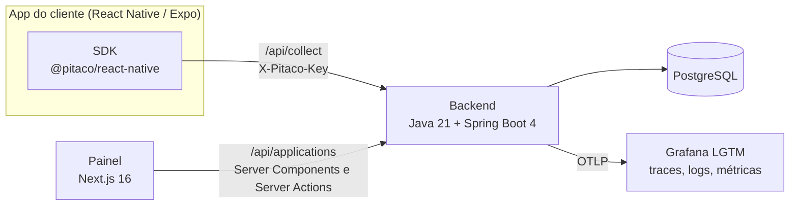

<div align="center">

# Pitaco

**Pesquisas curtas dentro do seu app, no momento certo — sem entregar seus usuários a terceiros.**

[](https://github.com/renanloureiroo/pitaco/actions/workflows/backend.yml)
[](https://github.com/renanloureiroo/pitaco/actions/workflows/painel.yml)
[](https://github.com/renanloureiroo/pitaco/actions/workflows/sdk.yml)
[](LICENSE)
[](https://github.com/github/spec-kit)

[Funcionalidades](#funcionalidades) ·
[Arquitetura](#arquitetura) ·
[Rodar em 5 minutos](#rodar-em-5-minutos) ·
[Specs](#desenvolvimento-guiado-por-especificação) ·
[Contribuir](CONTRIBUTING.md)


</div>

O Pitaco é uma plataforma auto-hospedada de pesquisas in-app. O **painel** web monta, publica e
lê as pesquisas (NPS, CSAT, CES, funil, taxa de resposta); o **SDK React Native** as exibe dentro
do app quando um evento acontece; o **backend** decide quem é elegível, entrega a pesquisa e
coleta as respostas.

```tsx
<PitacoProvider baseUrl="https://pitaco.sua-empresa.com/api" apiKey="pk_...">
  <App />
</PitacoProvider>

// depois do checkout:
usePitaco().track('checkout.completed');
```

## Por que o Pitaco

- **Seus dados ficam com você.** Backend, banco e painel rodam na sua infraestrutura. O SDK nunca
  envia nada para ferramentas de terceiros, e nenhum evento carrega texto digitado.
- **Pergunta no momento certo.** Disparo por evento do app, janela, amostragem, segmentação por
  atributo, prioridade entre pesquisas, cota e intervalo de descanso — tudo decidido no servidor.
- **Pesquisa que evolui sem estragar a série.** Publicar congela uma versão; mudar abre outra, e o
  painel mostra quais versões podem ser somadas com segurança.
- **Falha do Pitaco é silêncio no app.** O SDK não tem módulo nativo, funciona offline com fila
  persistente e nunca derruba a árvore do app hospedeiro.

## Funcionalidades

| Área | O que tem |
| --- | --- |
| **Aplicações e chaves** | Uma aplicação por app integrado, chaves de acesso com segredo exibido uma única vez, revogação imediata, limite de requisições por chave e por origem |
| **Montagem** | Modelos NPS (0–10), CSAT (1–5) e CES 2.0 (1–7), seis tipos de pergunta, perguntas condicionais, arrastar e soltar, pré-visualização ao vivo com o renderizador real do SDK |
| **Disparo e exposição** | Evento do app, janela, amostragem, segmentação, prioridade, cota de respostas, intervalo de descanso e catálogo dos eventos que o app já enviou |
| **Publicação e versões** | Impedimentos e avisos antes de publicar, classificação da mudança (cosmética ou semântica), grupos de comparabilidade, pausar/retomar/encerrar com histórico |
| **Análise** | Visão geral com KPIs e variação, análise por segmento, resultados por pergunta, recortes compartilháveis pela URL, respostas abertas com busca, export CSV |
| **Comportamento** | Funil por pergunta, tempo ativo (mediana e p90), vias de dispensa e sinais de atrito, a partir de um catálogo fechado de eventos de interação |
| **Saúde do SDK** | Versões em uso, erros reportados pelo SDK, pesquisas suprimidas e evento de disparo que nunca chegou |
| **Privacidade** | Retenção com descarte automático que preserva os agregados, exclusão do titular com auditoria, aviso contra dado pessoal em texto livre |
| **SDK React Native** | Bottom sheet, modal, inline e headless; tema, textos, slots e renderizadores substituíveis; fila offline; zero módulo nativo; Expo Go |

O inventário completo, com onde cada item mora no código e em que tela aparece, está em
[`docs/FEATURES.md`](docs/FEATURES.md).

## Arquitetura



- **Duas superfícies na mesma API.** A pública (`/collect`) é consumida pelo SDK, autenticada
  pela chave da aplicação e protegida por limite de requisições. A administrativa
  (`/applications/**`) é consumida pelo painel e recusa a chave do SDK.
- **O navegador nunca fala com o backend.** No painel, toda leitura acontece em Server Component e
  toda escrita em Server Action.
- **Monólito modular, hexagonal e DDD tático.** Cada contexto (`app`, `survey`, `collect`,
  `results`, `privacy`) tem `domain`, `application` e `infra`; domínio e núcleo são Java puro, e
  módulos só se falam por portas.
- **O SDK em três camadas.** Um core headless (máquina de estado, fila, transporte), a UI padrão e
  as apresentações. Todo evento de interação nasce no core — qualquer UI, inclusive uma
  inteiramente sua, produz a mesma sequência de eventos.
- **Erros em RFC 9457** com `code` estável e `traceId` para ligar a resposta ao trace no Grafana.

Para ir fundo:

| Documento | O que traz |
| --- | --- |
| [`backend/docs/backend/arquitetura.md`](backend/docs/backend/arquitetura.md) | Camadas, peças do núcleo, fluxo de uma requisição e manual de criação de módulos |
| [`backend/docs/backend/contrato-sdk.md`](backend/docs/backend/contrato-sdk.md) | O contrato público `/collect` consumido pelo SDK |
| [`backend/docs/backend/proxy.md`](backend/docs/backend/proxy.md) | O que um gateway do app precisa repassar ao Pitaco |
| [`backend/docs/adrs`](backend/docs/adrs) | Decisões de arquitetura e o que se aceitou pagar por elas |
| [`painel/DESIGN.md`](painel/DESIGN.md) | O Design System do painel |
| [`ops/DEPLOY.md`](ops/DEPLOY.md) · [`ops/RUNBOOK.md`](ops/RUNBOOK.md) | Publicação, backup, restore e resposta a incidentes |

## Rodar em 5 minutos

Com Docker, a stack inteira (Postgres, API, painel e Grafana) e uma demo com dados fictícios:

```bash
git clone https://github.com/renanloureiroo/pitaco.git && cd pitaco
cp .env.example .env                  # preencha POSTGRES_PASSWORD (openssl rand -base64 24)
docker compose -f compose.yaml -f compose.local.yaml up -d --build
seed/carregar-demo.sh                 # três aplicações, nove pesquisas, ~4 mil exibições
```

| O quê | Onde |
| --- | --- |
| Painel | http://localhost:3001 |
| API | http://localhost:8080/api |
| Swagger UI | http://localhost:8080/api/swagger-ui.html |
| Grafana | http://localhost:3000 |

A demo é descrita em [`seed/README.md`](seed/README.md). Para publicar num servidor, com túnel
reverso e backup, siga o [`ops/DEPLOY.md`](ops/DEPLOY.md).

### Desenvolvendo cada parte

Pré-requisitos: JDK 21, Docker e Node.js 22 (`painel/.nvmrc`). Para o app de exemplo, um simulador
iOS ou emulador Android.

| Parte | Como subir | Guia |
| --- | --- | --- |
| Backend | `cd backend && ./mvnw spring-boot:run` | [`backend/README.md`](backend/README.md) |
| Painel | `cd sdk && npm ci && npm run build`, depois `cd painel && npm ci --install-links && npm run dev` | [`painel/README.md`](painel/README.md) |
| SDK | `cd sdk && npm ci && npm run verify` | [`sdk/README.md`](sdk/README.md) |
| App de exemplo | `cd sdk/example && npm ci && npm run seed && npx expo start` | [`sdk/example/README.md`](sdk/example/README.md) |

### Testes

Cada parte tem um portão único, o mesmo que o CI roda:

| Parte | Comando | O que roda |
| --- | --- | --- |
| Backend | `cd backend && ./mvnw verify` | Mais de 1.800 testes (unidade, contrato, E2E com Testcontainers) e empacotamento |
| Painel | `cd painel && npm run verify` | ESLint, tipos, Vitest e Playwright contra um simulador da API |
| SDK | `cd sdk && npm run verify` | ESLint, tipos, Jest, build e checagem do app de exemplo |

## Stack

| Parte | Tecnologias |
| --- | --- |
| Backend | Java 21 (virtual threads), Spring Boot 4.1, PostgreSQL 16, Flyway, springdoc-openapi, OpenTelemetry, Maven |
| Painel | Next.js 16 (App Router), React 19, TypeScript estrito, Tailwind CSS 4, shadcn/ui, Recharts, dnd-kit, Zod |
| SDK | TypeScript, React Native ≥ 0.74 e Expo, sem módulo nativo; AsyncStorage ou MMKV; react-native-builder-bob |
| Testes | JUnit 5, AssertJ, Testcontainers · Vitest, Testing Library, Playwright · Jest |
| Operação | Docker Compose, túnel reverso, Grafana LGTM, backup com pg_dump + rclone, GitHub Actions |

## Desenvolvimento guiado por especificação

Toda funcionalidade do Pitaco passou pelo fluxo do [Spec Kit](https://github.com/github/spec-kit):
**especificar → esclarecer → planejar → quebrar em tarefas → implementar**, sob uma constituição
por parte com princípios e portões de qualidade. Cada spec traz `spec.md` (histórias, requisitos e
critérios de sucesso), `plan.md`, `research.md` (decisões e alternativas), `data-model.md`,
`contracts/`, `quickstart.md` e `tasks.md`.

| Parte | Constituição | Specs |
| --- | --- | --- |
| Backend | [`backend/.specify/memory/constitution.md`](backend/.specify/memory/constitution.md) | [13 funcionalidades](backend/specs) — de chaves de acesso a eventos de interação |
| Painel | [`painel/.specify/memory/constitution.md`](painel/.specify/memory/constitution.md) | [6 funcionalidades](painel/specs) — da operação de pesquisas ao Design System v2 |
| SDK | [`sdk/.specify/memory/constitution.md`](sdk/.specify/memory/constitution.md) | [6 funcionalidades](sdk/specs) — do core headless ao app de exemplo |
| Operação | princípios do backend | [2 funcionalidades](ops/specs) — publicação, observabilidade e backup; demo |

## Estrutura

```text
.
├── backend/          API Java + Spring Boot — specs/, docs/ (arquitetura, contratos, ADRs)
├── painel/           Painel web em Next.js — specs/, DESIGN.md, e2e/
├── sdk/              SDK @pitaco/react-native — specs/
│   └── example/      App Expo: harness de integração com painel de depuração
├── seed/             Demo completa com dados fictícios
├── ops/              Guia de publicação, runbook, backup — specs/
├── docs/             Inventário de funcionalidades e capturas
├── compose.yaml      Stack de produção (postgres, api, painel, backup opcional)
└── compose.local.yaml  Override para rodar a stack inteira na sua máquina
```

## Segurança

A superfície administrativa (`/api/applications/**`) e o painel ainda não têm autenticação de
usuário: exponha publicamente só `/api/collect/**` e mantenha o resto atrás de uma rede privada ou
de um proxy com autenticação. Para reportar uma vulnerabilidade, siga o [`SECURITY.md`](SECURITY.md).

## Contribuindo

Contribuições são bem-vindas — leia o [`CONTRIBUTING.md`](CONTRIBUTING.md). Funcionalidade nova
começa por uma spec.

## Autor

Feito por Renan Loureiro ([@renanloureiroo](https://github.com/renanloureiroo)), desenvolvedor full
stack (React Native, Node.js e Java/Spring Boot) com foco em arquitetura de software e
desenvolvimento guiado por especificação.

## Licença

[MIT](LICENSE)
