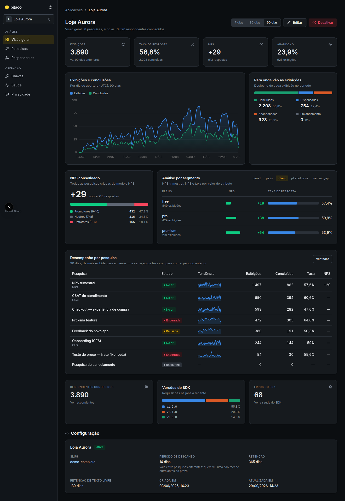
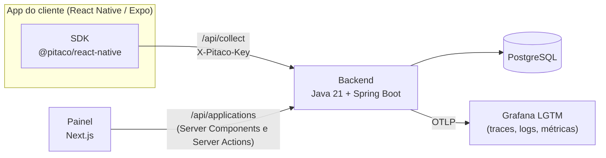

# Pitaco

Plataforma de pesquisas curtas dentro de aplicativos. O painel web monta, publica e lê as
pesquisas (NPS, CSAT, CES, funil, taxa de resposta); o SDK React Native as exibe dentro do app
quando um evento acontece; o backend decide quem é elegível, serve a pesquisa e coleta as
respostas.



<!-- TODO: link para a demo pública, se o Renan quiser divulgar uma (hoje a API administrativa não tem autenticação; ver SECURITY.md). -->

## Para quem é

- Para quem desenvolve apps React Native ou Expo e quer perguntar algo ao usuário no momento
  certo (depois do checkout, depois do onboarding), sem depender de ferramenta de terceiros.
- Para quem quer ler um projeto de ponta a ponta com domínio não trivial: pesquisa versionada,
  comparabilidade entre versões, retenção de dados, fila offline e idempotência de reenvio.

É um projeto pessoal. Escrevi o Pitaco para praticar arquitetura e desenvolvimento guiado por
especificação (SDD) com IA em algo real, e o mantenho como peça de portfólio.

## Funcionalidades

O inventário completo, com onde cada item mora no código e em que tela aparece, está em
[`docs/FEATURES.md`](docs/FEATURES.md). Em resumo:

- **Aplicações e chaves de acesso.** Cada app integrado é uma aplicação com chaves próprias para
  o SDK. O segredo aparece uma única vez; a chave pode ser revogada.
- **Montagem de pesquisas.** Modelos NPS (0 a 10), CSAT (1 a 5) e CES 2.0 (1 a 7), seis tipos de
  pergunta, perguntas condicionais, reordenação por arrastar e soltar e pré-visualização ao vivo
  com o renderizador real do SDK.
- **Disparo e exposição.** Evento do app, janela de exibição, amostragem, segmentação por
  atributo, prioridade entre pesquisas, cota de respostas e intervalo de descanso.
- **Publicação e versões.** Publicar congela a versão; mudanças abrem uma versão nova, e o painel
  mostra quais versões podem ser somadas com segurança.
- **Análise.** Visão geral com exibições, taxa de resposta, NPS e abandono; resultados por
  pergunta; análise por segmento; funil de comportamento; respostas abertas e export CSV.
- **Saúde do SDK.** Versões em uso, erros reportados pelo SDK e pesquisas suprimidas.
- **Privacidade.** Política de retenção com descarte automático, exclusão de respondente com
  auditoria e aviso para não escrever dado pessoal em texto livre.
- **SDK React Native.** Bottom sheet, modal, inline e headless; tema e textos customizáveis;
  fila offline persistente; sem módulo nativo.

## Arquitetura



- **Duas superfícies na mesma API.** A superfície pública (`/collect`) é consumida pelo SDK e
  autenticada pela chave da aplicação no header `X-Pitaco-Key`, com limite de requisições por
  chave e por origem. A superfície administrativa (`/applications/**`) é consumida pelo painel e
  recusa a chave do SDK.
- **O navegador nunca fala com o backend.** No painel, toda leitura acontece em Server Component e
  toda escrita em Server Action.
- **Backend como monólito modular com arquitetura hexagonal.** Cada contexto de negócio (`app`,
  `survey`, `collect`, `results`, `privacy`) tem as camadas `domain`, `application` e `infra`.
  O núcleo e o domínio são Java puro, sem Spring, HTTP ou JPA; portas de repositório ficam em
  `application` e os adaptadores em `infra`. Módulos não se conhecem pelo domínio: quando um
  precisa do outro, declara uma porta (gateway).
- **DDD tático.** Entidades com identidade tipada, value objects como `record` que se validam no
  construtor, casos de uso como interfaces funcionais com um único `execute` e erros com `code`
  estável no formato `<contexto>.<motivo>`.
- **Erros em RFC 9457.** Toda resposta de erro sai como `application/problem+json`, com `code` e
  `traceId` para ligar a resposta ao trace no Grafana.
- **Observabilidade.** OpenTelemetry exporta traces, logs e métricas por OTLP para a stack
  Grafana LGTM.
- **Desenvolvimento guiado por especificação.** Cada funcionalidade nasce como spec, plano e
  tarefas com o [Spec Kit](https://github.com/github/spec-kit), sob uma constituição com
  princípios e portões de qualidade. As specs ficam em [`backend/specs`](backend/specs) e
  [`painel/specs`](painel/specs).

Para ir fundo:

| Documento | O que traz |
| --- | --- |
| [`backend/docs/backend/arquitetura.md`](backend/docs/backend/arquitetura.md) | Camadas, peças do núcleo, fluxo de uma requisição e manual de criação de módulos |
| [`backend/docs/backend/testes.md`](backend/docs/backend/testes.md) | Os tipos de teste do backend e a receita de cada um |
| [`backend/docs/adrs`](backend/docs/adrs) | Decisões de arquitetura |
| [`backend/.specify/memory/constitution.md`](backend/.specify/memory/constitution.md) | Constituição do backend: princípios e portões de qualidade |
| [`backend/docs/backend/contrato-sdk.md`](backend/docs/backend/contrato-sdk.md) | Contrato público `/collect` consumido pelo SDK |
| [`backend/docs/backend/proxy.md`](backend/docs/backend/proxy.md) | O que um gateway do app precisa repassar ao Pitaco |
| [`painel/DESIGN.md`](painel/DESIGN.md) | Design system do painel |
| [`ops/RUNBOOK.md`](ops/RUNBOOK.md) | Operação: subir, backup, restore e incidentes |

<!-- TODO: contrato-sdk.md, proxy.md e o .env.example do exemplo citam "ADR-0008", mas só o ADR-0001 está versionado. Publicar os demais ADRs ou ajustar as referências. -->

## Stack

| Parte | Tecnologias |
| --- | --- |
| Backend | Java 21 (virtual threads), Spring Boot 4.1 (Web MVC, Data JPA, Validation, Actuator), PostgreSQL, Flyway, springdoc-openapi, OpenTelemetry, Lombok, Maven |
| Testes do backend | JUnit 5, AssertJ, Testcontainers (Postgres e Grafana LGTM) |
| Painel | Next.js 16 (App Router), React 19, TypeScript estrito, Tailwind CSS 4, shadcn/ui, Recharts, dnd-kit, Zod |
| Testes do painel | Vitest, Testing Library, Playwright |
| SDK | TypeScript, React Native (>= 0.74) e Expo, sem módulo nativo; armazenamento em AsyncStorage ou MMKV; build com react-native-builder-bob |
| Testes do SDK | Jest; app de exemplo em Expo com fluxos Maestro |
| Infra | Docker Compose, Cloudflare Tunnel, Grafana LGTM, GitHub Actions (um workflow por parte) |

## Como rodar localmente

### Pré-requisitos

- JDK 21
- Docker (o backend sobe o Postgres e o Grafana LGTM pelo Docker Compose)
- Node.js 22 (o painel fixa a versão em `painel/.nvmrc`; o app de exemplo do SDK pede 22.18 ou
  mais novo)
- Para o app de exemplo: simulador iOS (Xcode) ou emulador Android (Android Studio)

### 1. Backend

```bash
cd backend
cp src/main/resources/application-local.yml.example src/main/resources/application-local.yml
./mvnw spring-boot:run
```

O `spring-boot-docker-compose` sobe o Postgres e o Grafana LGTM de `backend/compose.yaml` e injeta
as conexões. As migrations do Flyway rodam na subida.

| O quê | Onde |
| --- | --- |
| API | http://localhost:8080/api |
| Swagger UI | http://localhost:8080/api/swagger-ui.html |
| Actuator | http://localhost:8080/api/actuator |
| Grafana | http://localhost:3000 |

### 2. Painel

Em outro terminal, com o backend de pé:

```bash
cd painel
cp .env.example .env.local   # PITACO_API_URL=http://localhost:8080/api
npm install
npm run dev                  # http://localhost:3001
```

<!-- TODO: confirmar se o painel precisa do SDK compilado (cd sdk && npm ci && npm run build) antes do npm install em desenvolvimento. O Dockerfile do painel faz isso e instala com --install-links; o painel/README.md e o CI não fazem. -->

### 3. SDK e app de exemplo

```bash
cd sdk/example
npm install
npm run seed                           # simulador iOS
# npm run seed -- --target android-emu # emulador Android
npx expo start                         # depois "i" para iOS ou "a" para Android
```

O `seed` cria uma aplicação de exemplo, emite a chave, cria e publica uma pesquisa e escreve o
`.env` do exemplo. No app, abra o cenário **1. Sheet do SDK** e toque em **Disparar pesquisa**.
O passo a passo completo, com aparelho físico e proxy, está em
[`sdk/example/README.md`](sdk/example/README.md). A referência da API do SDK está em
[`sdk/README.md`](sdk/README.md).

<!-- TODO: o pacote @pitaco/react-native ainda está marcado como private e não foi publicado no npm. Definir se e quando publicar. -->

### Stack completa com Docker e dados de demonstração

O `compose.yaml` da raiz é o de produção (o homelab): sobe `postgres`, `api` e `painel`, mas não
publica nenhuma porta no host, porque a entrada é um Cloudflare Tunnel numa rede externa `edge`.
Para subir assim:

```bash
docker network create edge     # uma vez por máquina
cp .env.example .env           # preencha POSTGRES_PASSWORD (openssl rand -base64 24)
docker compose up -d --build
seed/carregar-demo.sh          # carrega a demo completa (dados fictícios) direto no Postgres
```

A demo traz três aplicações, nove pesquisas e alguns milhares de exibições fictícias para todos os
gráficos do painel terem o que mostrar. Detalhes em [`seed/README.md`](seed/README.md). O guia de
publicação está em [`ops/DEPLOY-HOMELAB.md`](ops/DEPLOY-HOMELAB.md).

<!-- TODO: oferecer um compose de desenvolvimento (ou override) que publique as portas da api e do painel e inclua o Grafana LGTM, para quem quiser rodar a stack completa e a demo sem túnel. -->

### Testes

| Parte | Comando | O que roda |
| --- | --- | --- |
| Backend | `cd backend && ./mvnw verify` | Suíte completa e empacotamento (Docker precisa estar de pé) |
| Painel | `cd painel && npm run verify` | Lint, tipos, Vitest e Playwright contra um simulador de API |
| SDK | `cd sdk && npm run verify` | Lint, tipos, Jest, build e checagem do app de exemplo |

## Estrutura de pastas

```text
.
├── backend/        API em Java 21 + Spring Boot (specs, ADRs e docs em backend/docs)
├── painel/         Painel web em Next.js
├── sdk/            SDK @pitaco/react-native
│   └── example/    App Expo que serve de harness de integração do SDK
├── seed/           Demo completa com dados fictícios e script de carga
├── ops/            Runbook, guia de publicação e scripts de backup
├── docs/           Inventário de funcionalidades e prompts usados no desenvolvimento
├── compose.yaml    Stack de produção (postgres, api, painel)
└── .github/        Workflows de CI (backend, painel, sdk, compose)
```

## Como contribuir

Contribuições são bem-vindas. Leia o [`CONTRIBUTING.md`](CONTRIBUTING.md) antes de abrir uma
issue ou um pull request. Para reportar uma vulnerabilidade, siga o [`SECURITY.md`](SECURITY.md)
e não abra issue pública.

## Autor

Sou Renan Loureiro ([@renanloureiroo](https://github.com/renanloureiroo)), desenvolvedor full stack
(React Native, Node.js e Java/Spring Boot), com foco em arquitetura de software e em
desenvolvimento guiado por especificação com IA.

<!-- TODO: links do Renan (LinkedIn, site) se ele quiser incluir. -->

## Licença

Distribuído sob a licença MIT. Veja [`LICENSE`](LICENSE).
