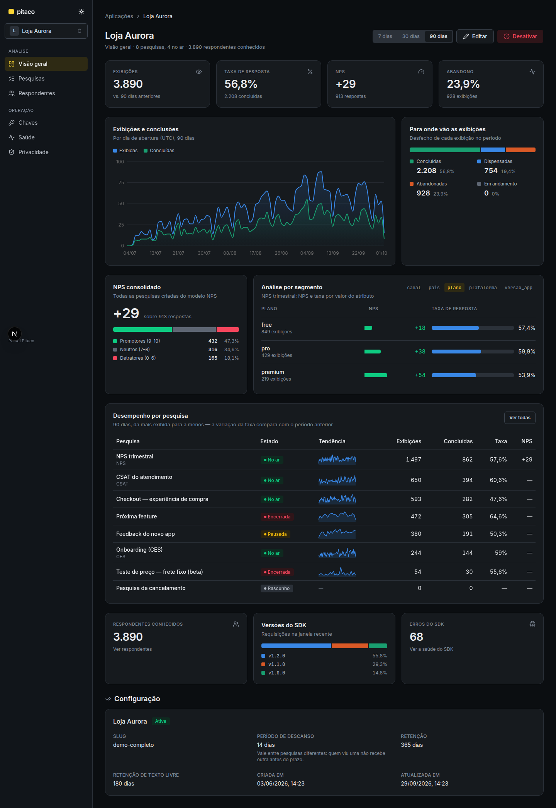

# Painel Pitaco

Superfície administrativa do [Pitaco](../README.md): aplicações, chaves de acesso e pesquisas
ponta a ponta — montagem com pré-visualização ao vivo, disparo e exposição, publicação, versões,
ciclo de vida, exibições, resultados, comportamento e export —, mais a saúde do SDK e as operações
de privacidade de cada aplicação.



Next.js 16 (App Router) + React 19 + TypeScript estrito, shadcn/ui sobre Tailwind CSS v4, Recharts
e dnd-kit. Toda leitura acontece em Server Component; toda escrita, em Server Action. **Nada no
navegador fala com o backend.** O visual segue o [Design System v2](DESIGN.md).

## Telas

| Rota | O que tem |
| --- | --- |
| `/aplicacoes` | Lista e cadastro de aplicações |
| `/aplicacoes/{id}` | Visão geral: KPIs com variação, tendência diária, desfechos, NPS consolidado, análise por segmento e desempenho por pesquisa |
| `/aplicacoes/{id}/chaves` | Emissão e revogação de chaves do SDK |
| `/aplicacoes/{id}/pesquisas/nova` | Criar em branco ou por modelo (NPS, CSAT, CES) |
| `/aplicacoes/{id}/pesquisas/{id}` | Montagem: perguntas, condições, arrastar e soltar e pré-visualização com o renderizador real do SDK |
| `…/disparo` · `…/publicacao` · `…/versoes` | Evento, janela, amostragem, segmentação e exposição; impedimentos e avisos; versões e comparabilidade |
| `…/resultados` · `…/comportamento` · `…/exibicoes` | Resultados por pergunta com recortes e export CSV; funil e atrito; exibições com detalhe |
| `/aplicacoes/{id}/respondentes` | Respondentes e histórico de cada um |
| `/aplicacoes/{id}/saude` | Versões do SDK em uso e erros reportados |
| `/aplicacoes/{id}/privacidade` | Política de retenção, exclusão de respondente e auditoria |

## Configuração

Copie `.env.example` para `.env.local`:

```bash
cp .env.example .env.local
```

| Variável | Obrigatória | Descrição |
|---|---|---|
| `PITACO_API_URL` | sim | URL base da API do Pitaco, **já incluindo** o `context-path` `/api` do backend (ex.: `http://localhost:8080/api`). |

É a única variável. Ela é lida **somente no servidor** — não há equivalente `NEXT_PUBLIC_*`,
porque nenhuma requisição ao backend parte do navegador. Sem ela, a primeira leitura falha com
mensagem explícita em vez de tentar uma URL relativa.

## Rodar

A pré-visualização da montagem usa o SDK (`@pitaco/react-native`, via `file:../sdk`) sobre
react-native-web. O pacote precisa estar compilado, e `--install-links` copia o SDK para
`node_modules` em vez de criar um symlink, que o Turbopack recusa por estar fora da raiz do
projeto:

```bash
(cd ../sdk && npm ci && npm run build)
npm ci --install-links
npm run dev     # http://localhost:3001 → redireciona para /aplicacoes
```

Mudou o SDK? Rode `npm run build` nele e `npm ci --install-links` aqui de novo.

Para desenvolver contra dados reais, suba o backend em `../backend` respondendo em
`http://localhost:8080/api`.

## Scripts

| Script | O que faz |
|---|---|
| `npm run dev` | servidor de desenvolvimento |
| `npm run build` / `npm start` | build de produção e execução |
| `npm run lint` | ESLint |
| `npm run typecheck` | `tsc --noEmit`, modo estrito |
| `npm run test` | Vitest (schemas, cliente HTTP, apresentadores, componentes cliente) |
| `npm run test:e2e` | Playwright (os fluxos de cada tela, contra o simulador de API) |
| `npm run verify` | tudo acima — portão de merge da constituição |

## Testes

**O E2E não precisa do backend.** O `fetch` do painel roda no servidor Node, fora do alcance da
interceptação de rota do Playwright, então o `playwright.config.ts` sobe dois servidores: o
simulador de API em `e2e/stub-api/` e o Next apontando para ele.

```bash
npm run test:e2e                 # contra o simulador (padrão)
E2E_API=real npm run test:e2e    # contra o backend real em PITACO_API_URL
```

Cada teste E2E cria sua própria aplicação e trabalha só dentro dela — é o que dá isolamento com
`fullyParallel: true`, sem reset global.

### Fluxos cobertos pelo E2E

| Spec | Fluxo |
| --- | --- |
| `smoke` | a raiz leva à listagem de aplicações |
| `aplicacoes` | cadastrar, listar, editar, desativar e reativar aplicação |
| `chaves` | emitir, listar e revogar chave de acesso |
| `pesquisas` | criar pesquisa, montar e reordenar perguntas, inclusive arrastando |
| `disparo` | evento com sugestões observadas, janela, amostragem, segmentação e exposição |
| `publicacao` | impedimentos, avisos de competição e compatibilidade, e publicar |
| `ciclo-de-vida` | pausar, retomar, encerrar, e o histórico com o encerramento por cota |
| `autoria-avancada` | modelos NPS/CSAT/CES, duplicação, condição entre perguntas e comparabilidade |
| `coleta` | exibições e respondentes, com filtros e detalhe |
| `resultados` | agregados, taxa de resposta, respostas abertas, recortes e export CSV |
| `saude` | versões do SDK, erros reportados, supressão e evento nunca recebido |
| `privacidade` | exclusão de respondente com confirmação, auditoria, aviso de descarte e aviso de texto livre |

Server Components assíncronos não são testados em unidade (limitação documentada pelo próprio
Next.js); por isso cada `page.tsx` é uma casca fina e a lógica vive em módulo puro coberto por
Vitest. Rede real é proibida no Vitest: `fetch` é substituído por `vi.stubGlobal`.

## Estrutura

```text
src/
├── app/         # só roteamento, layout e composição
├── features/    # domínio, com a fronteira em index.ts de cada um:
│                #   applications, api-keys, surveys, collect, results, analytics,
│                #   health, privacy
├── shared/      # cliente HTTP, componentes de estado, formatação
└── components/ui/  # primitivos shadcn (CLI)
e2e/             # Playwright + simulador de API em stub-api/
```

As regras que governam essa estrutura estão na [constituição](.specify/memory/constitution.md) do
painel.

## Specs

Cada funcionalidade nasceu como spec, plano e tarefas ([Spec Kit](https://github.com/github/spec-kit)):

| Spec | O que entrega |
| --- | --- |
| [`001-painel-operacao-pesquisas`](specs/001-painel-operacao-pesquisas) | Aplicações, chaves e pesquisas ponta a ponta: montagem, disparo, publicação e ciclo de vida |
| [`002-painel-leitura-coleta`](specs/002-painel-leitura-coleta) | Exibições, respostas e respondentes |
| [`003-painel-autoria-avancada`](specs/003-painel-autoria-avancada) | Modelos, condicionais, pré-visualização ao vivo, exposição e comparabilidade |
| [`004-painel-resultados-comportamento`](specs/004-painel-resultados-comportamento) | Resultados, recortes, respostas abertas, export e comportamento |
| [`005-painel-saude-privacidade`](specs/005-painel-saude-privacidade) | Saúde do SDK e privacidade |
| [`006-painel-design-system-v2`](specs/006-painel-design-system-v2) | Design System v2, shell com sidebar e visão geral analítica |
