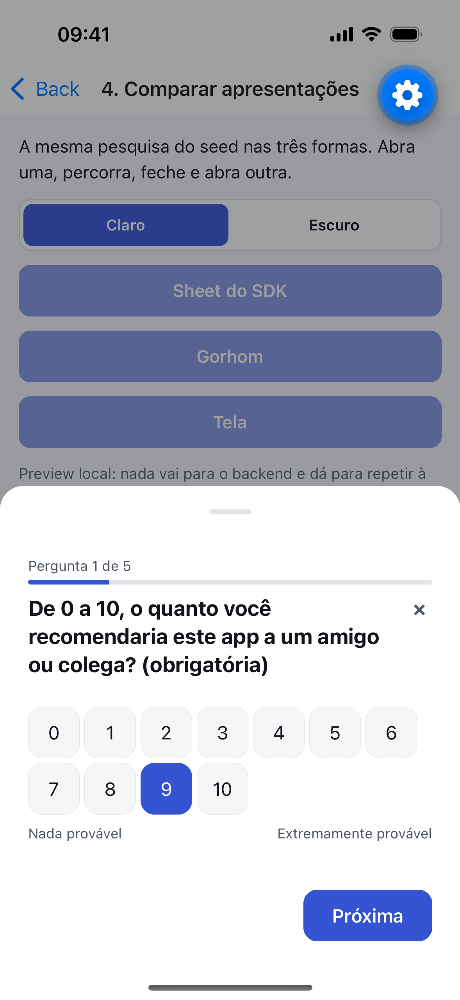
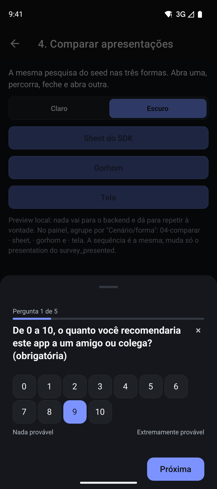
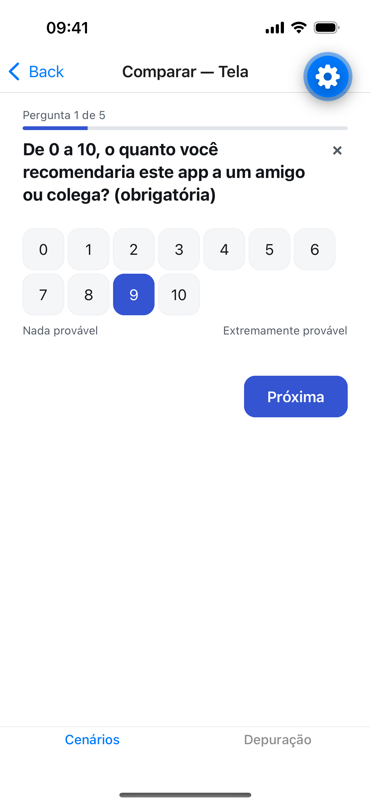

# @pitaco/react-native

SDK React Native e Expo do [Pitaco](../README.md): pesquisas curtas dentro do app, disparadas por
eventos, com a apresentação pronta (bottom sheet, modal, inline) ou totalmente headless.

- **Zero módulo nativo.** Só `react` e `react-native` como peer dependencies. Funciona no Expo Go,
  instala com `npm install`, sem rebuild.
- **Falha do Pitaco é silêncio no app.** Nenhum erro do SDK chega ao usuário nem derruba a árvore;
  configuração inválida avisa só em desenvolvimento.
- **O servidor decide.** Amostragem, segmentação, cota, intervalo de descanso e desempate são do
  backend; o SDK exibe o que recebeu.
- **Offline primeiro.** Abertura, envio e eventos entram numa fila persistente, com reenvio
  ordenado e idempotente.
- **Sem dado pessoal.** Nenhum evento carrega texto digitado, e nada vai para ferramentas de
  terceiros.

<p align="center">
  
  
  
</p>

## Instalação

O pacote ainda não está publicado no npm. Enquanto isso, instale a partir deste repositório:

```bash
git clone https://github.com/renanloureiroo/pitaco.git
cd pitaco/sdk && npm ci && npm run build
# no seu app:
npm install ../caminho/para/pitaco/sdk
```

Requer `react >= 18.2` e `react-native >= 0.74`. Para persistir a fila entre aberturas do app,
instale também um armazenamento — o SDK traz adaptadores prontos, sem depender deles:

```tsx
import AsyncStorage from '@react-native-async-storage/async-storage';
import { createAsyncStorageAdapter } from '@pitaco/react-native/storage/async-storage';
// ou: import { createMmkvAdapter } from '@pitaco/react-native/storage/mmkv';

const storage = createAsyncStorageAdapter(AsyncStorage);
```

Sem `storage`, a fila fica em memória e se perde quando o app fecha.

## Do zero à primeira pesquisa

**1. Envolva o app no provider:**

```tsx
import { PitacoProvider } from '@pitaco/react-native';

export default function App() {
  return (
    <PitacoProvider
      baseUrl="https://pitaco.sua-empresa.com/api"
      apiKey="pk_SUA_CHAVE_AQUI"
      storage={storage}
    >
      <SuaNavegacao />
    </PitacoProvider>
  );
}
```

**2. Dispare um evento:**

```tsx
import { Button } from 'react-native';
import { usePitaco } from '@pitaco/react-native';

export function TelaDeSucesso() {
  const pitaco = usePitaco();
  return <Button title="Concluir pedido" onPress={() => pitaco.track('pedido_concluido')} />;
}
```

Se houver uma pesquisa publicada para esse evento e o respondente for elegível, ela abre num
bottom sheet do próprio SDK, feito só com `Modal`, `Animated` e `PanResponder` do React Native.
A chave e a pesquisa são criadas no painel; o passo a passo com o backend local está no
[app de exemplo](example/README.md).

## Apresentação

| `presentation` | Como aparece |
| --- | --- |
| `'bottom-sheet'` (padrão) | Folha que sobe de baixo, com arrastar, toque no fundo e voltar do Android para fechar |
| `'modal'` | Tela cheia |
| `'inline'` | O SDK não abre contêiner: o app posiciona `<PitacoSurveyContent />` onde quiser (sheet próprio, rota da navegação) ou usa `usePitacoSurvey()` para uma UI própria |

Tema (cores, espaçamento, raio, tipografia, com validação de contraste), textos, slots de
cabeçalho/rodapé/agradecimento e o renderizador de cada tipo de pergunta são substituíveis pelo
provider. Um renderizador próprio que lança erro cai no padrão, sem derrubar a pesquisa.

## Referência da API

### `PitacoProvider`

| Propriedade | Tipo | Padrão | Descrição |
| --- | --- | --- | --- |
| `baseUrl` | `string` | **obrigatório** | Prefixo que serve `/collect` (ex.: `https://pitaco.exemplo.com/api`). Pode ser o seu gateway, se ele for transparente — ver [`proxy.md`](../backend/docs/backend/proxy.md) |
| `apiKey` | `string` | **obrigatório** | Chave da aplicação, emitida no painel |
| `respondent` | `{ reference?: string \| null }` | `null` | Identificador do usuário no seu sistema. Sem ele, o SDK usa um `deviceId` anônimo gerado no aparelho |
| `attributes` | `Record<string, string \| number \| boolean>` | `{}` | Atributos para segmentação (ex.: `{ plano: 'pro' }`) |
| `storage` | `PitacoStorage` | memória | Persistência da fila e da identidade (AsyncStorage ou MMKV) |
| `presentation` | `'bottom-sheet' \| 'modal' \| 'inline'` | `'bottom-sheet'` | Contêiner padrão |
| `theme` | `PitacoThemeConfig` | tema padrão | Cores, espaçamentos, raio e fontes |
| `strings` | `PartialPitacoStrings` | pt-BR | Textos da interface padrão |
| `renderers` | `Partial<PitacoRendererMap>` | padrão | Visual de cada tipo de pergunta |
| `slots` | `Partial<PitacoSlotMap>` | padrão | Partes da moldura (cabeçalho, rodapé, agradecimento) |
| `onEvent` | `(event) => void` | — | Ouve os eventos do catálogo e de posicionamento, para o seu analytics |
| `errorReporting` | `boolean` | `true` | Envia relatórios de falha do SDK, sanitizados, ao backend do Pitaco |
| `debug` | `boolean` | `__DEV__` | Avisos de integração no console |
| `eligibilityTimeoutMs` | `number` | `3000` | Tempo máximo da consulta de elegibilidade |
| `deferTimeoutMs` | `number` | 5 min | Quanto uma pesquisa fica retida por `defer()` ou `block()` antes de ser descartada |
| `insets` / `getInsets` | `EdgeInsets` / `() => EdgeInsets` | zeros | Áreas seguras, para o SDK não depender de `react-native-safe-area-context` |

### `usePitaco()`

| Método | O que faz |
| --- | --- |
| `track(evento, atributos?)` | Consulta a elegibilidade para o evento. Nunca rejeita; falha é silêncio |
| `setRespondent(respondent)` | Troca o respondente |
| `setAttributes(atributos)` | Troca os atributos de segmentação |
| `reset()` | Logout: dispensa a pesquisa aberta, esquece respondente e atributos e troca o `deviceId` |
| `block(motivo?)` / `unblock(motivo?)` | Impede a exibição enquanto o motivo estiver ativo (telas de pagamento, por exemplo). Prefira `<PitacoBlock />`, que pareia os dois com a montagem |
| `defer()` / `release()` | Represa a próxima pesquisa e a libera num momento melhor |
| `diagnostics()` | Estado interno (identidade, fila, bloqueios), para ferramentas de diagnóstico |

### Outros exports

| Export | Para quê |
| --- | --- |
| `usePitacoSurvey()` | Estado e ações da pesquisa atual, para UI headless ou contêiner próprio |
| `<PitacoSurveyContent />` | O conteúdo padrão da pesquisa, sem contêiner |
| `<PitacoBlock reason="..." />` | Bloqueia a exibição enquanto estiver montado |
| `@pitaco/react-native/preview` | `<PitacoPreview />`, o mesmo renderizador sem transporte — é o que o painel usa na pré-visualização |
| `@pitaco/react-native/storage/async-storage`, `/storage/mmkv` | Adaptadores de armazenamento |

## Guias de integração

### Com `@gorhom/bottom-sheet` 

O Pitaco não exige o Gorhom, mas convive perfeitamente com ele. Para usar, ajuste `presentation="inline"` e desenhe o sheet no seu app:

```tsx
import { BottomSheetModal } from '@gorhom/bottom-sheet';
import { PitacoSurveyContent, usePitacoSurvey } from '@pitaco/react-native';

export function MeuSheetGorhom() {
  const { available, present, dismiss } = usePitacoSurvey();

  // Quando `available` for true, você abre o seu BottomSheetModal.
  // Dentro dele, renderize:
  return (
    <BottomSheetModal onDismiss={() => dismiss('swipe')}>
      <PitacoSurveyContent presentDeferred={true} />
    </BottomSheetModal>
  );
}
```

### Como tela no React Navigation 

Se preferir que a pesquisa seja uma tela em vez de um modal:

```tsx
import { PitacoSurveyContent } from '@pitaco/react-native';

// Na sua configuração de rota, direcione para este componente:
export function TelaDePesquisa({ navigation }) {
  return (
    <PitacoSurveyContent
      onFinish={() => navigation.goBack()}
    />
  );
}
```

### UI 100% Headless 

Você pode descartar a UI padrão inteiramente e construir a sua sobre o estado do core. Como todo
evento de interação nasce na máquina de estado do core, e não nos componentes, uma UI própria
emite exatamente a mesma sequência de eventos que a padrão:

```tsx
import { useEffect } from 'react';
import { Button, Text, View } from 'react-native';
import { usePitacoSurvey } from '@pitaco/react-native';

// Com presentation="inline" no provider, o SDK não abre contêiner nenhum.
export function MinhaPesquisaCustomizada() {
  const survey = usePitacoSurvey();

  useEffect(() => {
    if (survey.status === 'ready') survey.present('inline');
  }, [survey.status]);

  if (survey.status !== 'presented' || !survey.question) return null;

  return (
    <View>
      <Text>{survey.question.statement}</Text>
      {/* survey.select(valor), survey.setText(texto), survey.back() ... */}
      <Button title={survey.isLast ? 'Enviar' : 'Próxima'} onPress={() => survey.next()} />
      <Button title="Fechar" onPress={() => survey.dismiss('close_button')} />
    </View>
  );
}
```

---

## Por que a pesquisa não apareceu?

Em produção, o Pitaco degrada silenciosamente e nunca quebra o seu app. Se uma pesquisa não aparecer quando você espera, use `usePitaco().diagnostics()` ou o **painel de depuração** do [app de exemplo](example/README.md). Motivos comuns de silêncio:

1. **Limite por sessão:** Por padrão, apenas uma pesquisa é exibida por sessão do aplicativo.
2. **Tempo de espera estourado:** Se a rede estiver lenta e a API demorar mais que o `eligibilityTimeoutMs` (3s).
3. **Bloqueio ativo:** Você chamou `block()` (ou está renderizando `<PitacoBlock />`) e não liberou.
4. **Falta de rede / Backend inacessível:** A requisição falhou, e o SDK desistiu para não impactar a performance.
5. **Critérios do servidor:** O servidor negou (ex: já respondeu antes, cota atingida, não está na amostragem).
6. **Versão incompatível:** A pesquisa requer perguntas que a versão do SDK instalada não conhece.

---

## Privacidade

O SDK do Pitaco foi desenhado para ser seguro por padrão:

- **O que enviamos:** Respostas estruturadas (valores numéricos e escolhas predefinidas), tamanho de texto livre digitado (nunca o conteúdo), tempos de resposta e identificadores opacos.
- **O que NUNCA enviamos:** Textos livres digitados pelos usuários. Nenhuma ferramenta de terceiros ou Analytics próprio do seu app recebe dados de respostas do SDK automaticamente.
- **⚠️ Aviso importante:** **Nunca** envie dados pessoais identificáveis (PII, como nome, email, CPF ou telefone) em `attributes` ou na propriedade `reference`. Use hashes (como SHA-256) do ID do seu banco de dados se precisar conciliar dados.

---

## Catálogo de Eventos

O SDK emite eventos estruturados para que você envie ao seu Analytics via a prop `onEvent` do `PitacoProvider`.

Envelope comum a todos os eventos:
```json
{
  "catalogVersion": 1,
  "displayId": "uuid-v4",
  "seq": 1,
  "occurredAt": "2026-09-14T10:00:00.000Z",
  "elapsedMs": 1500,
  "type": "...",
  "data": { ... }
}
```
*(Eventos referentes a uma pergunta específica incluem a propriedade `"questionKey"` ao lado do `type`)*.

### Exemplos de Payload (`data`) por Tipo:

1. **`survey_presented`**: O contêiner ficou visível.
   `{ "presentation": "bottom-sheet", "questionCount": 3, "renderableCount": 3, "triggerEvent": "pedido_concluido" }`
2. **`question_viewed`**: Uma pergunta passou a ser a atual.
   `{ "position": 1, "visit": 1, "from": "start" }`
3. **`answer_selected`**: Primeira escolha ou opção adicionada.
   `{ "value": "opcao_1" }`
4. **`answer_changed`**: Escolha trocada.
   `{ "from": 5, "to": 8 }`
5. **`answer_deselected`**: Opção removida ou limpa.
   `{ "value": "opcao_1" }`
6. **`text_focused`**: Campo de texto recebeu foco.
   `{}`
7. **`text_edited`**: Texto alterado (debounce 1s).
   `{ "length": 42 }`
8. **`text_blurred`**: Campo perdeu o foco.
   `{ "length": 42 }`
9. **`validation_blocked`**: Tentou avançar sem responder obrigatória.
   `{ "reason": "required_missing" }`
10. **`question_skipped`**: Avançou pergunta opcional em branco.
    `{}`
11. **`question_not_applicable`**: Condição pulou a pergunta.
    `{ "sourceKey": "pergunta_1" }`
12. **`navigated_next`**: Avançou (botão Próxima).
    `{ "toKey": "pergunta_3" }`
13. **`navigated_back`**: Voltou (botão Voltar).
    `{ "toKey": "pergunta_1" }`
14. **`question_left`**: A pergunta deixou de ser a atual.
    `{ "visit": 1, "to": "next", "durationMs": 3500, "activeMs": 3500, "answered": true }`
15. **`survey_backgrounded`**: O app foi para segundo plano.
    `{}`
16. **`survey_foregrounded`**: O app voltou com a pesquisa aberta.
    `{ "backgroundMs": 15000 }`
17. **`survey_dismissed`**: O usuário fechou a pesquisa antes do fim.
    `{ "via": "swipe", "position": 2, "answeredCount": 1 }`
18. **`survey_completed`**: Enviou a última pergunta.
    `{ "answeredCount": 3, "skippedCount": 0, "notApplicableCount": 0, "activeMs": 12500 }`

---

## Desenvolvimento

```bash
npm ci
npm run verify   # lint, tipos, Jest, build (bob) e lint/tipos do app de exemplo
npm run gen:api  # regenera os tipos do cliente a partir de openapi/pitaco.json
```

| Pasta | O que tem |
| --- | --- |
| `src/core` | Headless: configuração, identidade, máquina de estado da pesquisa, fila, transporte, relógio |
| `src/catalog` | O catálogo versionado de eventos de interação |
| `src/ui` | UI padrão: tipos de pergunta, tema, textos, slots e apresentações |
| `src/react` | Provider, hooks e o host das apresentações |
| `src/preview` | Pré-visualização sem transporte, usada pelo painel |
| `src/storage` | Adaptadores AsyncStorage e MMKV |
| `example/` | App Expo que dispara as pesquisas do seed em três formas de integrar, com painel de depuração |
| `specs/` | As specs de cada funcionalidade do SDK, sob a [constituição](.specify/memory/constitution.md) |

| Spec | O que entrega |
| --- | --- |
| [`001-sdk-core`](specs/001-sdk-core) | Provider, elegibilidade, máquina de estado, fila offline e transporte |
| [`002-sdk-ui-apresentacoes`](specs/002-sdk-ui-apresentacoes) | UI padrão, tema, textos, renderizadores e as apresentações |
| [`003-sdk-eventos-interacao`](specs/003-sdk-eventos-interacao) | Catálogo de eventos de interação e envio ao backend |
| [`004-sdk-controle-onde-quando`](specs/004-sdk-controle-onde-quando) | Bloqueio, adiamento e eventos de posicionamento |
| [`005-sdk-preview-web`](specs/005-sdk-preview-web) | Pré-visualização no painel com react-native-web |
| [`006-sdk-app-exemplo`](specs/006-sdk-app-exemplo) | O app de exemplo como harness de integração |

## Licença

MIT — veja [`LICENSE`](../LICENSE).
